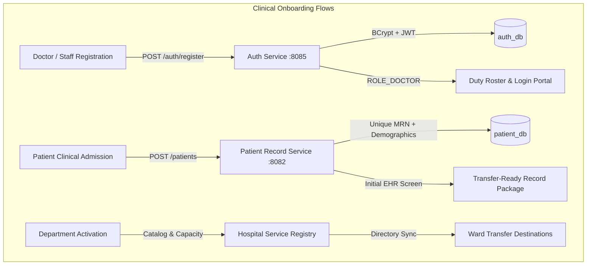

# 🏥 CareRelay — Clinical Handoff & Patient Referral Coordination Platform
## Implementation Design Document

> **Project type:** Primary portfolio project for MS CS admissions (PoliMi / Sapienza / Bologna)
> **Author:** Tushar Dalal
> **Stack:** Java · Spring Boot · PostgreSQL · Apache Kafka · Spring Cloud Gateway · Eureka · Resilience4j · JWT · Flyway · React · Tailwind CSS · Recharts · Docker Compose · Claude API

---

## Table of Contents

1. [Project Summary](#1-project-summary)
2. [What Problem Does It Solve?](#2-what-problem-does-it-solve)
3. [System Architecture Overview](#3-system-architecture-overview)
4. [Microservices — Detailed Breakdown](#4-microservices--detailed-breakdown)
5. [API Gateway](#5-api-gateway-spring-cloud-gateway)
6. [Kafka Event Schemas](#6-kafka-event-schemas)
7. [Saga Orchestration Flow](#7-saga-orchestration-flow)
8. [Flyway Migration Strategy](#8-flyway-migration-strategy)
9. [Resilience4j Configuration](#9-resilience4j-configuration)
10. [Docker Compose Stack](#10-docker-compose-stack)
11. [React Dashboard](#11-react-dashboard)
12. [Project Folder Structure](#12-project-folder-structure)
13. [Day-by-Day Build Roadmap](#13-day-by-day-build-roadmap)
14. [Resume Bullet Points](#14-resume-bullet-points)
15. [SOP Paragraph](#15-sop-paragraph)

---

## 1. Project Summary

**CareRelay** is a distributed, microservices-based platform that coordinates patient referrals across hospital departments. When a doctor initiates a referral, an orchestration-based Saga drives the entire lifecycle:

```
Request Created → Receiving Doctor Accepts → Patient Records Transferred → Handoff Confirmed
```

At every step, compensation/rollback logic fires automatically if something fails. An AI layer (Claude API) generates plain-English clinical handoff summaries from structured event data — replacing the handoff notes doctors and nurses write manually today.

### What this demonstrates for your SOP/resume

| Skill | How it is demonstrated |
|---|---|
| Distributed systems design | Microservices, Saga orchestration, Kafka event bus |
| Data integrity under failure | Saga compensation / rollback across 5 services |
| Security engineering | JWT + RBAC (Doctor / Nurse / Admin) |
| Database engineering | Schema-per-service, Flyway migrations, PostgreSQL |
| API design | RESTful APIs with filtering, pagination, full-text search |
| Resilience patterns | Circuit breakers (Resilience4j), retry, timeout |
| LLM integration | Safe retrieval-augmented approach → Claude API |
| Service mesh fundamentals | Spring Cloud Gateway, Eureka, Docker Compose |

---

## 2. What Problem Does It Solve?

### The real-world problem (without CareRelay)

In most hospitals today, when Dr. A (Cardiologist) needs to refer a patient to Dr. B (Neurologist):

- ❌ Dr. A calls Dr. B manually on the phone
- ❌ Patient records sent via email or fax
- ❌ Handoff notes written by hand
- ❌ No tracking — referrals get lost if Dr. B is busy
- ❌ SLA deadlines (e.g. "urgent cases within 2 hours") go unnoticed
- ❌ No audit trail if something goes wrong

### The solution (with CareRelay)

| Step | What happens |
|---|---|
| **1** | Dr. A fills in a referral form: patient, receiving dept, urgency level |
| **2** | System auto-notifies Dr. B instantly via Kafka |
| **3** | Patient records digitally packaged and transferred |
| **4** | Dr. B confirms receipt and handoff completion |
| **5** | Claude AI auto-generates a plain-English clinical summary |
| **Failure** | Saga compensation kicks in → records reverted, all parties notified |

---

## 3. System Architecture Overview

```
┌──────────────────────────────────────────────────────────────────┐
│                       React Dashboard                             │
│        (Referral board · Patient records · Notifications          │
│         Admin analytics · AI handoff summary panel)              │
└──────────────────────┬───────────────────────────────────────────┘
                       │ HTTPS (port 3000 → 8080)
┌──────────────────────▼───────────────────────────────────────────┐
│            API Gateway  (Spring Cloud Gateway · port 8080)        │
│        JWT validation · Rate limiting · Route forwarding          │
└────┬─────────────┬──────────────┬──────────────┬─────────────────┘
     │             │              │              │
     ▼             ▼              ▼              ▼
 Auth Svc      Referral Svc   Patient Rec.   Notification   AI-Insights
 (8085)        (8081) ⭐       Svc (8082)    Svc (8083)     Svc (8084)
               Saga owner
     │             │
     └─────────────┴──────────────────── Eureka (8761)
                   │
               Kafka Topics
           ┌────────────────────┐
           │ referral.created   │
           │ referral.accepted  │
           │ record.transferred │
           │ handoff.confirmed  │
           │ referral.cancelled │  ← compensation event
           └────────────────────┘

Databases (one per service):
  postgres-auth        : 5436
  postgres-referral    : 5433
  postgres-patient     : 5434
  postgres-notification: 5435
```

---

## 4. Microservices — Detailed Breakdown

---

### 4.1 Referral Service ⭐ (Saga Orchestrator)

**Port:** `8081`
**Database:** `referral_db` (PostgreSQL, port 5433)
**Responsibility:** Owns the referral lifecycle. Orchestrates the entire saga.

#### Entity Schemas

```sql
CREATE TABLE referrals (
    id                   UUID PRIMARY KEY DEFAULT gen_random_uuid(),
    patient_id           UUID NOT NULL,
    referring_doctor_id  UUID NOT NULL,
    receiving_doctor_id  UUID NOT NULL,
    referring_department VARCHAR(100) NOT NULL,
    receiving_department VARCHAR(100) NOT NULL,
    reason               TEXT,
    urgency              VARCHAR(20) NOT NULL CHECK (urgency IN ('ROUTINE','URGENT','EMERGENCY')),
    status               VARCHAR(30) NOT NULL DEFAULT 'PENDING',
    saga_step            VARCHAR(50) NOT NULL DEFAULT 'INITIATED',
    sla_deadline         TIMESTAMP WITH TIME ZONE,
    notes                TEXT,
    created_at           TIMESTAMP WITH TIME ZONE DEFAULT NOW(),
    updated_at           TIMESTAMP WITH TIME ZONE DEFAULT NOW()
);

CREATE TABLE saga_log (
    id           UUID PRIMARY KEY DEFAULT gen_random_uuid(),
    referral_id  UUID NOT NULL REFERENCES referrals(id),
    step_name    VARCHAR(100) NOT NULL,
    step_status  VARCHAR(30) NOT NULL,
    payload      JSONB,
    created_at   TIMESTAMP WITH TIME ZONE DEFAULT NOW()
);
```

#### REST API

| Method | Endpoint | Access | Description |
|---|---|---|---|
| POST | /api/v1/referrals | DOCTOR | Initiate referral (triggers saga step 1) |
| GET | /api/v1/referrals | DOCTOR, ADMIN | List referrals (filter: status, dept, urgency, date; paginated) |
| GET | /api/v1/referrals/{id} | DOCTOR, ADMIN | Referral detail + full saga audit trail |
| PUT | /api/v1/referrals/{id}/accept | DOCTOR | Receiving doctor accepts (triggers saga step 2) |
| PUT | /api/v1/referrals/{id}/confirm | DOCTOR | Final handoff confirmed (triggers saga step 4) |
| PUT | /api/v1/referrals/{id}/cancel | DOCTOR, ADMIN | Cancel — triggers compensation saga |
| GET | /api/v1/referrals/my-queue | DOCTOR | Logged-in doctor's pending referrals |
| GET | /api/v1/referrals/sla-breached | ADMIN | All referrals that breached their SLA |
| GET | /api/v1/referrals/analytics/summary | ADMIN | Aggregate stats for dashboard charts |

---

### 4.2 Patient Record Service

**Port:** `8082`
**Database:** `patient_record_db` (PostgreSQL, port 5434)

#### Entity Schemas

```sql
CREATE TABLE patients (
    id                UUID PRIMARY KEY DEFAULT gen_random_uuid(),
    mrn               VARCHAR(50) UNIQUE NOT NULL,
    first_name        VARCHAR(100) NOT NULL,
    last_name         VARCHAR(100) NOT NULL,
    date_of_birth     DATE NOT NULL,
    blood_group       VARCHAR(10),
    allergies         TEXT[],
    primary_doctor_id UUID,
    created_at        TIMESTAMP WITH TIME ZONE DEFAULT NOW()
);

CREATE TABLE medical_records (
    id           UUID PRIMARY KEY DEFAULT gen_random_uuid(),
    patient_id   UUID NOT NULL REFERENCES patients(id),
    record_type  VARCHAR(50) NOT NULL,
    title        VARCHAR(255) NOT NULL,
    content      JSONB NOT NULL,
    authored_by  UUID NOT NULL,
    department   VARCHAR(100),
    created_at   TIMESTAMP WITH TIME ZONE DEFAULT NOW()
);

CREATE TABLE record_transfers (
    id                     UUID PRIMARY KEY DEFAULT gen_random_uuid(),
    referral_id            UUID NOT NULL,
    patient_id             UUID NOT NULL REFERENCES patients(id),
    transferred_record_ids UUID[] NOT NULL,
    transfer_status        VARCHAR(20) NOT NULL DEFAULT 'PENDING',
    transferred_at         TIMESTAMP WITH TIME ZONE
);
```

#### REST API

| Method | Endpoint | Access | Description |
|---|---|---|---|
| POST | /api/v1/patients | ADMIN, DOCTOR | Register a new patient |
| GET | /api/v1/patients/{id} | DOCTOR, NURSE | Get patient detail |
| GET | /api/v1/patients/search | DOCTOR | Search by MRN or name |
| POST | /api/v1/patients/{id}/records | DOCTOR | Add a medical record |
| GET | /api/v1/patients/{id}/records | DOCTOR, NURSE | List records (filter by type, date) |
| POST | /api/v1/records/transfer-request | Internal | Called by Referral Service |
| GET | /api/v1/records/transfer/{referralId} | DOCTOR | Get transfer package |
| DELETE | /api/v1/records/transfer/{referralId} | Internal | Compensation: revoke transfer |

---

### 4.3 Notification Service

**Port:** `8083`
**Database:** `notification_db` (PostgreSQL, port 5435)

#### Entity Schema

```sql
CREATE TABLE notifications (
    id                UUID PRIMARY KEY DEFAULT gen_random_uuid(),
    recipient_user_id UUID NOT NULL,
    referral_id       UUID,
    event_type        VARCHAR(60) NOT NULL,
    title             VARCHAR(255) NOT NULL,
    body              TEXT NOT NULL,
    is_read           BOOLEAN DEFAULT FALSE,
    sent_at           TIMESTAMP WITH TIME ZONE DEFAULT NOW()
);
```

#### Kafka Consumers

| Topic | Notification sent |
|---|---|
| referral.created | Receiving doctor: "New referral waiting for your acceptance" |
| referral.accepted | Referring doctor: "Your referral was accepted" |
| record.transferred | Receiving doctor: "Patient records ready — please confirm handoff" |
| handoff.confirmed | Referring doctor: "Referral successfully completed" |
| referral.cancelled | All parties: cancellation reason |

#### REST API

| Method | Endpoint | Description |
|---|---|---|
| GET | /api/v1/notifications/my | Logged-in user's notifications (paginated) |
| PUT | /api/v1/notifications/{id}/read | Mark one as read |
| PUT | /api/v1/notifications/read-all | Mark all as read |

---

### 4.4 AI Insights Service

**Port:** `8084`
**Database:** None (stateless — reads from other services via HTTP)

> ⚠️ Security design: This service NEVER accepts raw SQL or free-form input that reaches the database. All retrieval is via typed, parameterized REST API calls. The LLM receives only an assembled, strongly-typed context object.

#### Safe Retrieval Flow

```
1. Receive referralId (UUID — validated, access-checked against JWT)
2. Fetch structured data via REST:
      a. GET /api/v1/referrals/{id}           → referral + saga audit trail
      b. GET /api/v1/records/transfer/{id}    → which records were transferred
      c. GET /api/v1/patients/{patientId}     → patient name, age, allergies
3. Assemble a strongly-typed Java DTO (NOT raw SQL output)
4. Load versioned prompt template from config
5. Call Claude API (claude-3-5-haiku or claude-3-5-sonnet)
6. Return and cache summary
```

#### REST API

| Method | Endpoint | Description |
|---|---|---|
| POST | /api/v1/ai/handoff-summary/{referralId} | Generate handoff summary |
| GET | /api/v1/ai/handoff-summary/{referralId} | Retrieve cached summary |
| POST | /api/v1/ai/ask | Scoped Q&A (admin only) |

---

### 4.5 Auth Service

**Port:** `8085`
**Database:** `auth_db` (PostgreSQL, port 5436)

```sql
CREATE TABLE users (
    id            UUID PRIMARY KEY DEFAULT gen_random_uuid(),
    email         VARCHAR(255) UNIQUE NOT NULL,
    password_hash VARCHAR(255) NOT NULL,
    role          VARCHAR(20) NOT NULL CHECK (role IN ('DOCTOR','NURSE','ADMIN')),
    department    VARCHAR(100),
    is_active     BOOLEAN DEFAULT TRUE,
    created_at    TIMESTAMP WITH TIME ZONE DEFAULT NOW()
);
```

**JWT Payload:** `{ sub, role, department, iat, exp }`

| Role | Permissions |
|---|---|
| DOCTOR | Create/accept/confirm referrals; view their patients |
| NURSE | View referrals and records for their department |
| ADMIN | Full read; SLA monitoring; user management; analytics |

---

## 5. API Gateway (Spring Cloud Gateway)

**Port:** `8080`

```yaml
spring:
  cloud:
    gateway:
      routes:
        - id: auth-service
          uri: lb://AUTH-SERVICE
          predicates: [Path=/api/v1/auth/**]

        - id: referral-service
          uri: lb://REFERRAL-SERVICE
          predicates: [Path=/api/v1/referrals/**]
          filters: [JwtAuthFilter]

        - id: patient-record-service
          uri: lb://PATIENT-RECORD-SERVICE
          predicates: [Path=/api/v1/patients/**, /api/v1/records/**]
          filters: [JwtAuthFilter]

        - id: notification-service
          uri: lb://NOTIFICATION-SERVICE
          predicates: [Path=/api/v1/notifications/**]
          filters: [JwtAuthFilter]

        - id: ai-insights-service
          uri: lb://AI-INSIGHTS-SERVICE
          predicates: [Path=/api/v1/ai/**]
          filters: [JwtAuthFilter]
```

---

## 6. Kafka Event Schemas

### referral.created
```json
{
  "eventType": "REFERRAL_CREATED",
  "eventId": "uuid",
  "timestamp": "2026-10-06T08:00:00Z",
  "referralId": "uuid",
  "patientId": "uuid",
  "referringDoctorId": "uuid",
  "receivingDoctorId": "uuid",
  "referringDepartment": "Cardiology",
  "receivingDepartment": "Neurology",
  "urgency": "URGENT",
  "slaDeadline": "2026-10-06T10:00:00Z"
}
```

### referral.accepted
```json
{
  "eventType": "REFERRAL_ACCEPTED",
  "eventId": "uuid",
  "timestamp": "2026-10-06T08:15:00Z",
  "referralId": "uuid",
  "acceptedByDoctorId": "uuid"
}
```

### record.transferred
```json
{
  "eventType": "RECORD_TRANSFERRED",
  "eventId": "uuid",
  "timestamp": "2026-10-06T08:20:00Z",
  "referralId": "uuid",
  "patientId": "uuid",
  "transferredRecordIds": ["uuid-1", "uuid-2"],
  "transferredAt": "2026-10-06T08:20:00Z"
}
```

### handoff.confirmed
```json
{
  "eventType": "HANDOFF_CONFIRMED",
  "eventId": "uuid",
  "timestamp": "2026-10-06T09:00:00Z",
  "referralId": "uuid",
  "confirmedByDoctorId": "uuid",
  "confirmedAt": "2026-10-06T09:00:00Z"
}
```

### referral.cancelled (Compensation Event)
```json
{
  "eventType": "REFERRAL_CANCELLED",
  "eventId": "uuid",
  "timestamp": "2026-10-06T08:25:00Z",
  "referralId": "uuid",
  "cancelledAtStep": "RECORD_TRANSFER_REQUESTED",
  "reason": "Receiving doctor unavailable",
  "compensationActions": ["REVOKE_RECORD_TRANSFER", "NOTIFY_ALL_PARTIES"]
}
```

---

## 7. Saga Orchestration Flow

```
╔══════════════════════════════════════════════════════════════════╗
║                    HAPPY PATH (no failures)                      ║
╚══════════════════════════════════════════════════════════════════╝

STEP 1 ─ Doctor calls POST /api/v1/referrals
    │   Creates referral: status=PENDING, saga_step=INITIATED
    │   Logs to saga_log: step=INITIATE, status=SUCCEEDED
    └──► Publishes: referral.created on Kafka

STEP 2 ─ Receiving doctor calls PUT /api/v1/referrals/{id}/accept
    │   Updates: status=ACCEPTED
    │   HTTP call → Patient Record Service: POST /records/transfer-request
    │   Logs to saga_log: step=RECORD_TRANSFER_REQUESTED, status=STARTED
    └──► Publishes: referral.accepted on Kafka

STEP 3 ─ Patient Record Service completes transfer
    │   Publishes: record.transferred on Kafka
    │   Referral Service CONSUMES event: status=RECORD_TRANSFERRED
    │   Logs to saga_log: step=RECORD_TRANSFER, status=SUCCEEDED
    └──► Notification triggered via Kafka

STEP 4 ─ Receiving doctor calls PUT /api/v1/referrals/{id}/confirm
    │   Updates: status=COMPLETED, saga_step=HANDOFF_CONFIRMED
    │   Logs to saga_log: step=HANDOFF_CONFIRM, status=SUCCEEDED
    └──► Publishes: handoff.confirmed
         └──► AI Insights Service generates summary

╔══════════════════════════════════════════════════════════════════╗
║               COMPENSATION FLOW (failure at Step 2/3)            ║
╚══════════════════════════════════════════════════════════════════╝

IF Patient Record Service call fails (circuit breaker / timeout / 5xx):
    │   Referral Service catches Resilience4j exception
    │   Logs to saga_log: step=RECORD_TRANSFER, status=FAILED
    │   status=FAILED, saga_step=COMPENSATING
    │   → DELETE /records/transfer/{id}  (if partially transferred)
    └──► Publishes: referral.cancelled (compensationActions=[REVOKE_RECORD_TRANSFER])
         └──► Notification Service notifies all parties
```

---

## 8. Flyway Migration Strategy

Each service has `/resources/db/migration/` with versioned SQL files.
**Naming:** `V{number}__{description}.sql`

### Referral Service Migrations

`V1__create_referrals_table.sql`
```sql
CREATE TABLE referrals (
    id                   UUID PRIMARY KEY DEFAULT gen_random_uuid(),
    patient_id           UUID NOT NULL,
    referring_doctor_id  UUID NOT NULL,
    receiving_doctor_id  UUID NOT NULL,
    referring_department VARCHAR(100) NOT NULL,
    receiving_department VARCHAR(100) NOT NULL,
    reason               TEXT,
    urgency              VARCHAR(20) NOT NULL CHECK (urgency IN ('ROUTINE','URGENT','EMERGENCY')),
    status               VARCHAR(30) NOT NULL DEFAULT 'PENDING',
    saga_step            VARCHAR(50)  NOT NULL DEFAULT 'INITIATED',
    sla_deadline         TIMESTAMP WITH TIME ZONE,
    notes                TEXT,
    created_at           TIMESTAMP WITH TIME ZONE DEFAULT NOW(),
    updated_at           TIMESTAMP WITH TIME ZONE DEFAULT NOW()
);
```

`V2__create_saga_log_table.sql`
```sql
CREATE TABLE saga_log (
    id           UUID PRIMARY KEY DEFAULT gen_random_uuid(),
    referral_id  UUID NOT NULL REFERENCES referrals(id),
    step_name    VARCHAR(100) NOT NULL,
    step_status  VARCHAR(30) NOT NULL,
    payload      JSONB,
    created_at   TIMESTAMP WITH TIME ZONE DEFAULT NOW()
);
```

`V3__add_indexes.sql`
```sql
CREATE INDEX idx_referrals_sla_deadline ON referrals(sla_deadline);
CREATE INDEX idx_referrals_status ON referrals(status);
CREATE INDEX idx_referrals_referring_doctor ON referrals(referring_doctor_id);
CREATE INDEX idx_referrals_receiving_doctor ON referrals(receiving_doctor_id);
```

---

## 9. Resilience4j Configuration

```yaml
# referral-service/src/main/resources/application.yml
resilience4j:
  circuitbreaker:
    instances:
      patientRecordService:
        slidingWindowSize: 10
        failureRateThreshold: 50
        waitDurationInOpenState: 10s
        permittedNumberOfCallsInHalfOpenState: 3
  retry:
    instances:
      patientRecordService:
        maxAttempts: 3
        waitDuration: 500ms
  timelimiter:
    instances:
      patientRecordService:
        timeoutDuration: 3s
```

**Fallback:** Circuit opens → Referral Service logs failure to saga_log → executes compensation → publishes referral.cancelled → no 500 crash surfaced to the doctor.

---

## 10. Docker Compose Stack

```yaml
version: '3.8'
services:
  zookeeper:
    image: confluentinc/cp-zookeeper:7.5.0
    environment:
      ZOOKEEPER_CLIENT_PORT: 2181

  kafka:
    image: confluentinc/cp-kafka:7.5.0
    depends_on: [zookeeper]
    ports: ["9092:9092"]
    environment:
      KAFKA_BROKER_ID: 1
      KAFKA_ZOOKEEPER_CONNECT: zookeeper:2181
      KAFKA_ADVERTISED_LISTENERS: PLAINTEXT://kafka:9092
      KAFKA_AUTO_CREATE_TOPICS_ENABLE: "true"

  eureka-server:
    build: ./eureka-server
    ports: ["8761:8761"]

  postgres-auth:
    image: postgres:16
    ports: ["5436:5432"]
    environment: { POSTGRES_DB: auth_db, POSTGRES_USER: postgres, POSTGRES_PASSWORD: postgres }

  postgres-referral:
    image: postgres:16
    ports: ["5433:5432"]
    environment: { POSTGRES_DB: referral_db, POSTGRES_USER: postgres, POSTGRES_PASSWORD: postgres }

  postgres-patient:
    image: postgres:16
    ports: ["5434:5432"]
    environment: { POSTGRES_DB: patient_record_db, POSTGRES_USER: postgres, POSTGRES_PASSWORD: postgres }

  postgres-notification:
    image: postgres:16
    ports: ["5435:5432"]
    environment: { POSTGRES_DB: notification_db, POSTGRES_USER: postgres, POSTGRES_PASSWORD: postgres }

  api-gateway:
    build: ./api-gateway
    ports: ["8080:8080"]
    depends_on: [eureka-server]

  auth-service:
    build: ./auth-service
    ports: ["8085:8085"]
    depends_on: [postgres-auth, eureka-server]

  referral-service:
    build: ./referral-service
    ports: ["8081:8081"]
    depends_on: [postgres-referral, kafka, eureka-server]

  patient-record-service:
    build: ./patient-record-service
    ports: ["8082:8082"]
    depends_on: [postgres-patient, kafka, eureka-server]

  notification-service:
    build: ./notification-service
    ports: ["8083:8083"]
    depends_on: [postgres-notification, kafka, eureka-server]

  ai-insights-service:
    build: ./ai-insights-service
    ports: ["8084:8084"]
    depends_on: [eureka-server]
    environment:
      CLAUDE_API_KEY: ${CLAUDE_API_KEY}

  carerelay-dashboard:
    build: ./carerelay-dashboard
    ports: ["3000:3000"]
    depends_on: [api-gateway]
```

---

## 11. React Dashboard

**Stack:** React · Tailwind CSS · Recharts · Axios · React Query

| Screen | Description |
|---|---|
| Login | JWT login form |
| Referral Board | Kanban: Pending → Accepted → Records Transferred → Completed |
| New Referral | Doctor form: patient search, reason, urgency, receiving dept |
| Referral Detail | Full timeline, saga audit trail, AI handoff summary panel |
| Patient Records | Patient search + medical record viewer |
| My Notifications | Real-time notification feed |
| Admin Dashboard | Charts: referrals by dept, SLA compliance, daily volume, SLA breach table |

---

## 12. Project Folder Structure

```
carerelay/
├── docker-compose.yml
├── .env.example
├── README.md
├── IMPLEMENTATION_DESIGN.md
├── eureka-server/
├── api-gateway/
│   └── src/main/filter/JwtAuthFilter.java
├── auth-service/
│   └── src/main/
│       ├── controller/AuthController.java
│       ├── service/AuthService.java
│       ├── security/JwtTokenProvider.java
│       └── resources/db/migration/
├── referral-service/                   ← ⭐ largest service
│   └── src/main/
│       ├── controller/ReferralController.java
│       ├── service/
│       │   ├── ReferralService.java
│       │   └── SagaOrchestrator.java   ← heart of the project
│       ├── kafka/
│       │   ├── ReferralEventPublisher.java
│       │   └── RecordTransferEventConsumer.java
│       ├── client/PatientRecordServiceClient.java  ← Resilience4j wrapped
│       └── resources/db/migration/
├── patient-record-service/
├── notification-service/
│   └── kafka/NotificationEventConsumer.java
├── ai-insights-service/
│   └── src/main/
│       ├── service/
│       │   ├── AiInsightsService.java
│       │   ├── ContextAssembler.java   ← safe retrieval layer
│       │   └── ClaudeApiClient.java
│       └── prompt/handoff_summary_v1.txt
└── carerelay-dashboard/
    └── src/pages/
        ├── Login.jsx
        ├── ReferralBoard.jsx
        ├── NewReferral.jsx
        ├── ReferralDetail.jsx
        ├── PatientRecords.jsx
        ├── Notifications.jsx
        └── AdminDashboard.jsx
```

---

## 13. Day-by-Day Build Roadmap

| Days | Milestone | Files/Services |
|---|---|---|
| **1–2** | Mono-repo setup, Docker Compose skeleton, Eureka + API Gateway running | docker-compose.yml, eureka-server/, api-gateway/ |
| **3–4** | Auth Service: register, login, JWT, RBAC | auth-service/ |
| **5–7** | Referral Service core: entities, Flyway, CRUD APIs, filtering + pagination | referral-service/ (no saga yet) |
| **8–9** | Patient Record Service: entities, APIs, record transfer endpoint | patient-record-service/ |
| **10–12** | ⭐ Saga implementation: SagaOrchestrator.java, Kafka events, compensation flow | referral-service/SagaOrchestrator.java |
| **13** | Notification Service: Kafka consumers, storage, REST API | notification-service/ |
| **14** | Resilience4j: circuit breaker + retry on Referral → Patient Record call | PatientRecordServiceClient.java |
| **15–16** | AI Insights Service: context assembler → Claude API → handoff summary | ai-insights-service/ |
| **17–18** | React Dashboard: referral board, detail view, notifications, admin analytics | carerelay-dashboard/ |
| **19** | E2E testing: happy path + failure/compensation scenarios | All services |
| **20** | README, architecture diagram, cleanup, push to GitHub | README.md |

---

## 14. Resume Bullet Points

```
CareRelay — Clinical Handoff & Patient Referral Coordination Platform  (Personal Project)
Tech Stack: Java · Spring Boot · PostgreSQL · Apache Kafka · Spring Cloud Gateway ·
            Eureka · Resilience4j · JWT · Flyway · React · Tailwind CSS · Docker Compose · Claude API

• Designed and built a distributed microservices platform coordinating patient referrals
  across hospital departments using an orchestration-based Saga pattern with full
  compensation/rollback logic across 5 independently deployed services.

• Implemented event-driven inter-service communication via Apache Kafka with structured
  event schemas spanning the full referral lifecycle (created → accepted → records
  transferred → handoff confirmed / cancelled with compensation).

• Built an API Gateway (Spring Cloud Gateway) with JWT validation and role-based access
  control (Doctor / Nurse / Admin), backed by Eureka service discovery and Resilience4j
  circuit breakers with configurable retry and timeout policies.

• Applied database-per-service pattern with 4 independent PostgreSQL instances versioned
  via Flyway migrations, ensuring strict service isolation and independent schema evolution.

• Integrated an LLM-powered AI layer (Claude API) using a safe retrieval-augmented
  approach: structured data fetched via typed REST APIs, assembled into a versioned
  prompt template, to generate plain-English clinical handoff summaries.

• Built a React + Tailwind CSS dashboard with a Kanban-style referral tracking board,
  real-time notification feed, and admin analytics panel with SLA compliance charts (Recharts).
```

---

## 15. SOP Paragraph

> *"In my primary project, CareRelay, I confronted a real distributed systems challenge: maintaining data consistency across independently deployed services without a shared database. I implemented an orchestration-based Saga pattern using Apache Kafka as the event bus, where the Referral Service acts as the saga coordinator — driving each step of the patient handoff workflow and executing compensating transactions on failure. This required careful design of idempotent consumers, explicit audit trails (the saga_log table), and circuit breakers to ensure graceful degradation when downstream services are unavailable. The AI integration layer was designed with a deliberate security constraint: the LLM never touches the database directly — instead, a typed retrieval layer assembles a structured context object passed to the Claude API via a versioned prompt template. This architecture enforces both security and explainability, which I believe are essential properties in any production healthcare system."*

---

---

## 16. Clinical Onboarding & Authentication Architecture

### 16.1 How Entities are Onboarded

CareRelay coordinates cross-ward clinical care by maintaining strict, isolated domains for each entity:



#### 1. Doctor / Clinical Staff Onboarding
* **Service:** `auth-service` (Port `8085`)
* **Endpoint:** `POST /api/v1/auth/register`
* **Payload:** First name, last name, professional hospital email, department affiliation, role (`DOCTOR`, `NURSE`, `ADMIN`), medical license #, and password.
* **Security Lifecycle:** Password hashed with BCrypt (strength 10), persisted to `users` table, and signed with HMAC-SHA256 JWT tokens containing role claims (`ROLE_DOCTOR`) and user UUID.
* **Workstation Availability:** The doctor is immediately added to the on-duty clinical roster and becomes selectable for instant login and case transfers.

#### 2. Patient Onboarding (Admission to Ward)
* **Service:** `patient-record-service` (Port `8082`)
* **Endpoint:** `POST /api/v1/patients`
* **Payload:** MRN (Medical Record Number, unique index), full name, date of birth, blood group, allergies (e.g., Penicillin, Latex), primary presenting condition, and assigned admitting doctor.
* **Record Initialization:** Concurrently seeds an admission baseline record (`POST /api/v1/patients/{id}/records`) containing vitals and clinical notes.
* **Referral Readiness:** The patient is indexed in the active inpatient pool, immediately eligible for cross-ward handoffs with SLA tracking.

#### 3. Department / Clinical Service Unit Onboarding
* **Domain Model:** Maintained across the clinical directory in `referral-service` and `patient-record-service`.
* **Attributes:** Department Name (e.g., *Cardiology*, *Neurology*, *Emergency*, *Intensive Care Unit (ICU)*, *Oncology*), Department Code (e.g., `CARD-01`), Wing/Floor Location, Department Head, and Bed/Acute capacity.
* **System-wide Propagation:** Instantly populated across all transfer destination selectors, staff affiliation rosters, and inpatient ward admission forms.

### 16.2 Doctor Authentication & Session Management
* **Dual Login Workflow:**
  1. **Quick Clinician Roster Sign-In (1-Click Switch):** Allows seamless switching during clinical shift handoffs between attending physicians (e.g. Dr. Alice Smith in Cardiology, Dr. Bob Johnson in Neurology, Nurse Carol Davis in Emergency).
  2. **Credentialed Sign-In:** Direct email and password authentication verified against `auth-service` with JWT session creation and automatic local fallback for offline development.
* **Top-Bar Clinician Context:** Displays active logged-in doctor, current department ward, active shift status, and immediate "Sign Out" / "Switch Clinician" controls.

---

## 17. Advanced Clinical Workstation & Distributed Systems Demonstrators

### 17.1 Interactive Saga Compensating Rollback Simulator
In academic evaluation (such as Politecnico di Milano or Sapienza admission committees), demonstrating the **happy path** of a microservice architecture is insufficient; what differentiates high-tier candidates is proving **fault tolerance and data consistency guarantees under distributed failure**.

CareRelay includes an interactive **Saga Rollback Simulator** accessible directly from the top navigation bar:
* **Simulated Failure Scenarios:**
  1. `BED_UNAVAILABLE` (Target Ward Bed Capacity Exhausted): Receiving ward encounters surge; zero acute beds remain.
  2. `CLINICAL_REJECTION` (Receiving Specialist Clinical Ineligibility): Receiving doctor reviews patient chart and deems patient unstable for transport.
  3. `EHR_TRANSFER_FAIL` (Medical Record Cryptographic Mismatch): Network failure or checksum corruption during patient record decryption.
  4. `RESILIENCE4J_TIMEOUT` (Downstream Service Timeout): Remote REST invocation exceeds 2000ms SLA, tripping Circuit Breaker from `CLOSED` ➔ `OPEN`.
* **Execution & Compensation Pipeline:**
  * When triggered, the UI visualizes the sequential compensating Kafka events firing across topics in real time:
    $$\text{Failure Injected} \longrightarrow \text{Revoke Medical Record JWT} \longrightarrow \text{Release Reserved Bed Hold} \longrightarrow \text{Write COMPENSATED State to saga\_log} \longrightarrow \text{Dispatch Emergency Alert}$$
  * Immediately transitions referral status to `CANCELLED & ROLLED BACK` with full immutable audit history.

### 17.2 Real-Time Hospital Ward Bed Map & Capacity Monitor
Transfers are physically constrained by acute bed availability. The **Ward Bed Map** view visualizes:
* **Global Hospital KPIs:** Total monitored acute beds across departments, occupied beds, overall hospital occupancy percentage, and active surge warnings.
* **Per-Ward Bed Matrix:** Individual unit status visualization (`OCCUPIED`, `RESERVED FOR INBOUND HANDOFF`, `AVAILABLE`).
* **Saga Reservation Synchronicity:** When a referral is created, an inbound bed hold is automatically reserved in the target ward; if the referral is accepted/completed, the bed becomes occupied; if rolled back, the hold is instantaneously deallocated.
* **Direct Transfer Initiation:** Clinicians can inspect any ward and launch a transfer request pre-targeted to that specific clinical service unit.

### 17.3 Real-Time Clinical Notification Drawer & Kafka Event Stream
Connects the user interface with the `notification-service` event store:
* **Live Event Ingestion:** Captures high-priority notifications across topics (`clinical.referral.events`, `clinical.patient.events`, `clinical.alerts`).
* **Priority-Based Filtering:** `All`, `🚨 Urgent (Emergency Triage)`, `⚡ Saga / System Audit Logs`.
* **Audio-Visual Alerts:** Optional Web Audio API chime with high-frequency alert harmonics when emergency transfers or rollback compensations are received.
* **1-Click Case Focus:** Clinicians can jump directly from any notification badge to the corresponding patient case file and AI clinical briefing.

---

*Document version: 1.2 — Full distributed systems resilience, ward capacity orchestration, and real-time Kafka notification streams integrated.*
